# Hi, I’m Dallin

I study computer science with an emphasis in machine learning at BYU. My research there focuses on evaluating language models and extracting data from historical documents. I also build [Red Scribe](#red-scribe) at Red Compass Health and co-founded [Argus Home](#argus-home), a stove-safety startup.

[Résumé (PDF)](assets/Dallin_Jacobs_Resume_Grad.pdf) · [LinkedIn](https://www.linkedin.com/in/dallin-jacobs-byu/) · [Email](mailto:dallin62@byu.edu)

## Research

### Faith and ethics in language models

In David Wingate’s lab, we study how language models handle questions about faith and ethics, including when their answers leave out religious perspectives. I built a pipeline to find everyday ethical questions in WildChat, helped analyze how models answered them, and released two Jacobian lenses for Qwen to explore what was happening inside the models.

[Read the preprint](https://arxiv.org/abs/2605.24319) · [Explore the Jacobian lenses](https://huggingface.co/dallinmj/Qwen3.5-Jacobian-Lenses)

### Extracting high-quality data from historical documents at scale

I lead the computer vision team in Joe Price’s Record Linking Lab. We turn scans of historical documents into structured data people can search and study. Our projects include World War I draft cards, the Mexican census, the 1920 U.S. census, Paris census records, U.S. land status records, and college yearbooks. I work on getting models to read these documents reliably and building OCR pipelines that can process them at scale.

## Projects

### Red Scribe

Clinicians can upload a visit recording, review a draft clinical note, and revise the treatment plan by speaking their edits. I built the charting workflow and work on how it connects to the clinic’s electronic health record.

[Live app](https://redscribe.redcompasshealth.com) (login required)

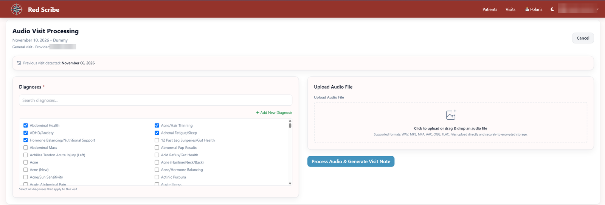

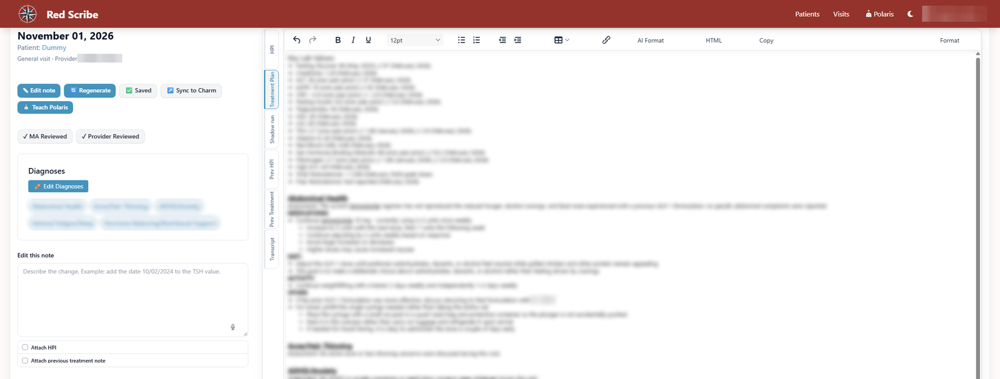

### Argus Home

I co-founded Argus Home to build a smart plug that lets people check whether their stove is on and turn it off remotely. I built the Flutter app and helped evaluate relays, circuit board layouts, and wiring options for the prototype.

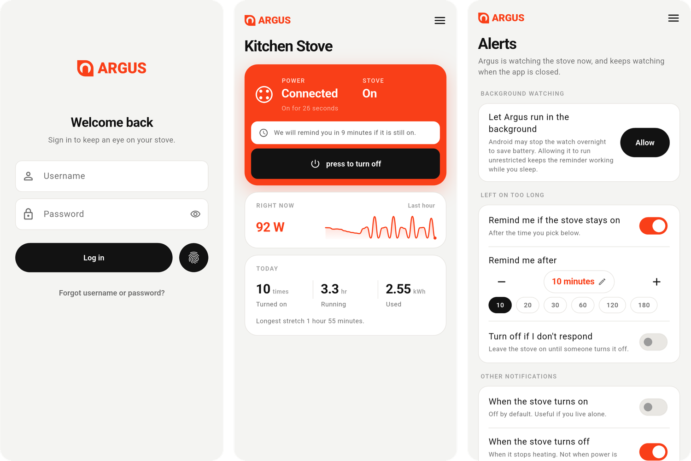

### Spruce

Record a quick voice recap after meeting someone, and Spruce turns it into a searchable contact with notes. We built it for BYU’s Homecoming Hackathon and took first place.

[Live app](https://spruce-c82fa.web.app/)

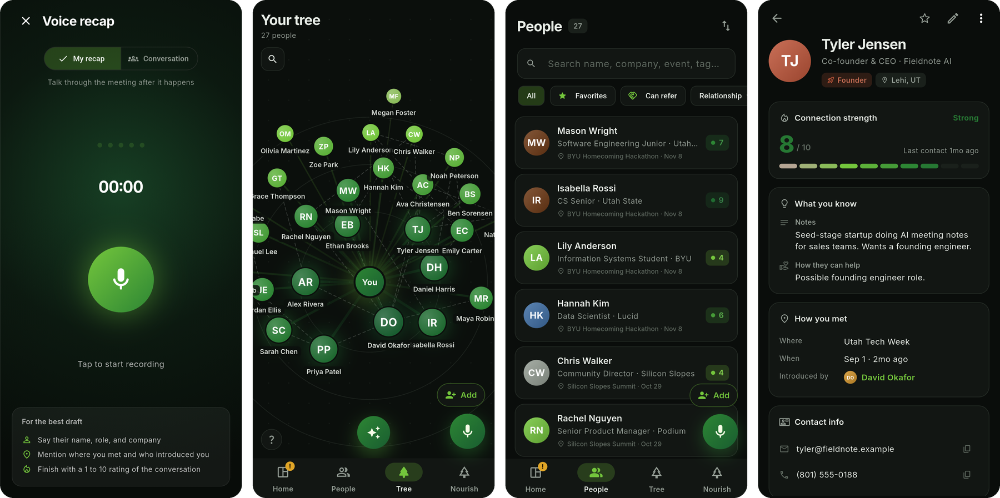

### Gospel Library 2.0

I built a scripture reader with side-by-side translations, search by meaning, and study notes alongside the verses.

[Live app](https://gospel-library.web.app)

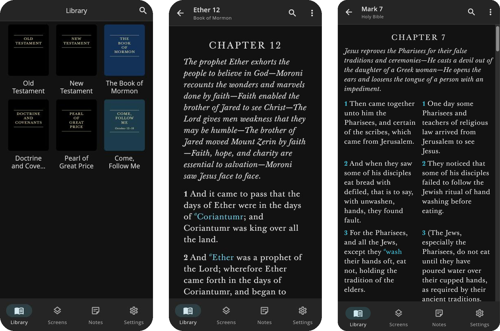

### Budget

A personal finance dashboard that imports transactions and tracks spending, savings goals, and net worth in a local database.

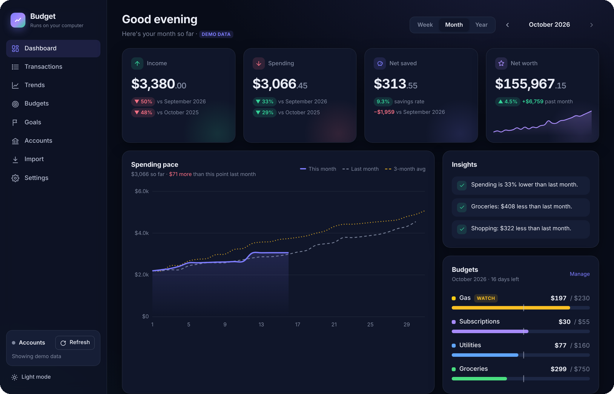

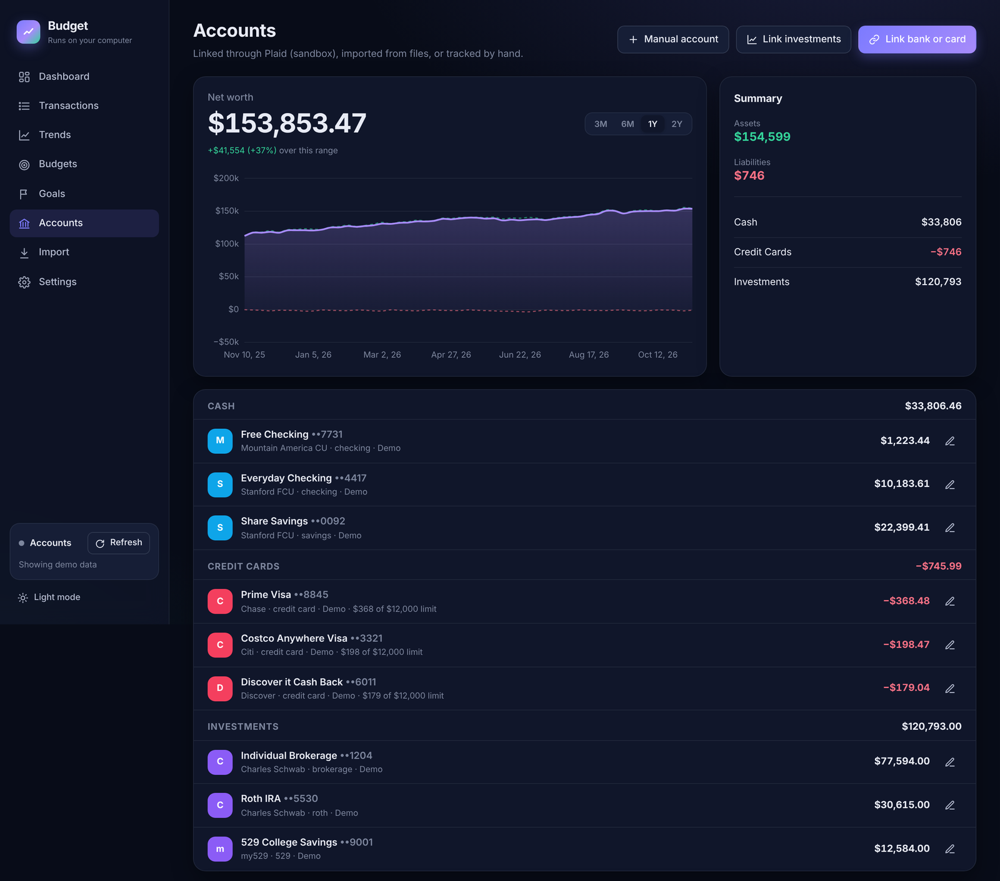

### Still

A distraction blocker for Android and Windows. I built it so a friend holds the code needed to turn off protection or take a break.

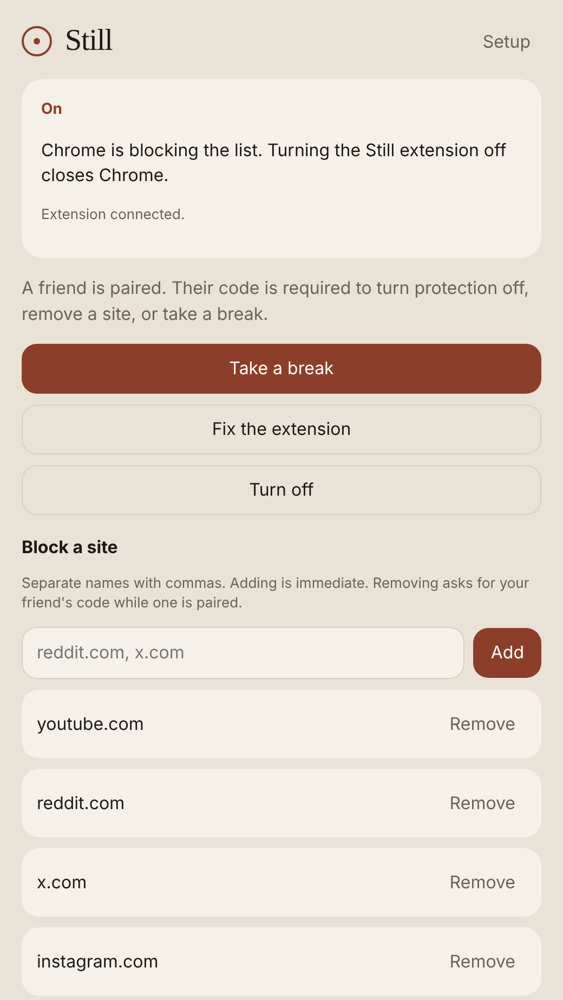&nbsp;&nbsp;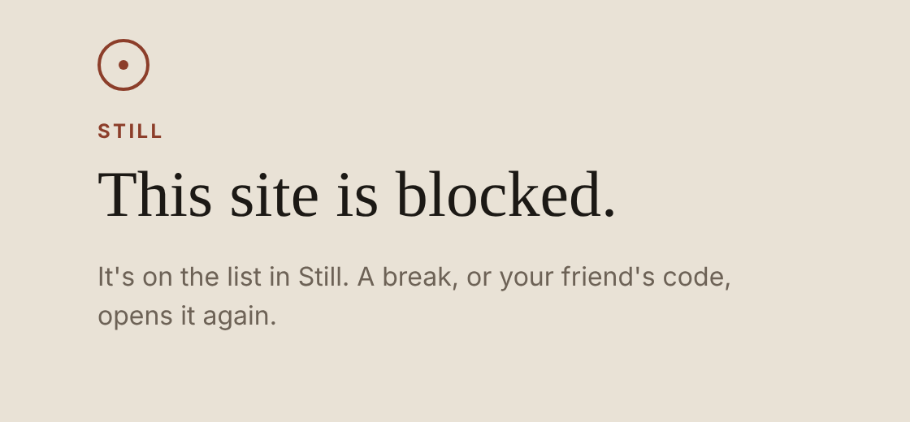

### Sib-journal

A voice-first journal that turns recordings into written entries and lets you find them later by what you remember talking about.

[Live app](https://dallinmj.github.io/Sib-journal/)

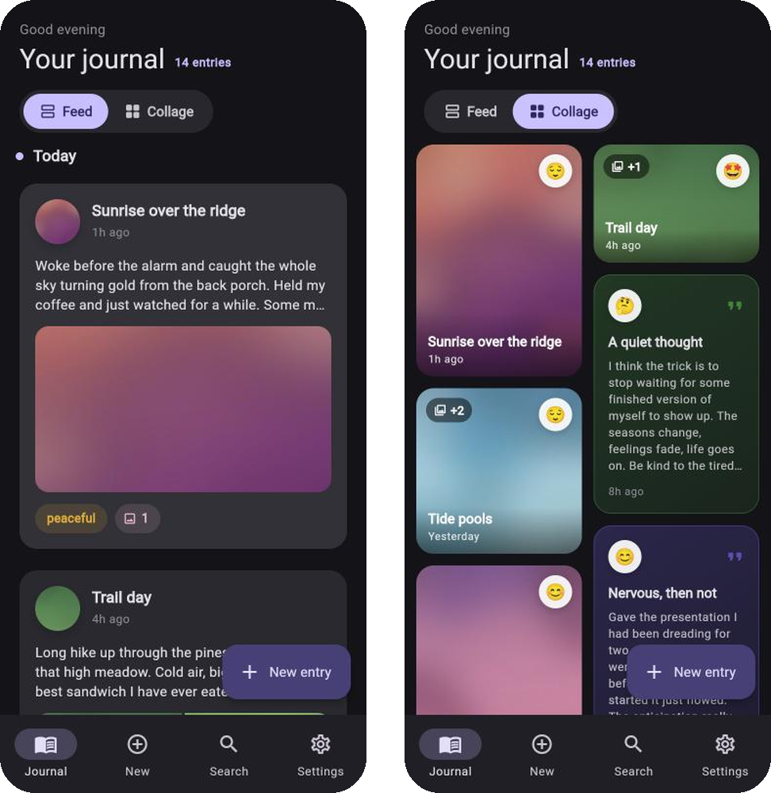

### ML Research Trends

We built an interactive explorer to see how different areas of machine learning research have grown over time and how papers cluster by topic.

[Project site](https://dallinmj.github.io/ml_research_trends/) · [Code](https://github.com/dallinmj/ml_research_trends)

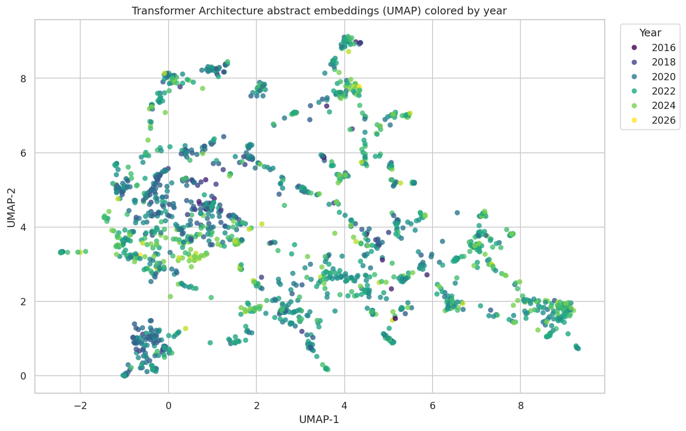

