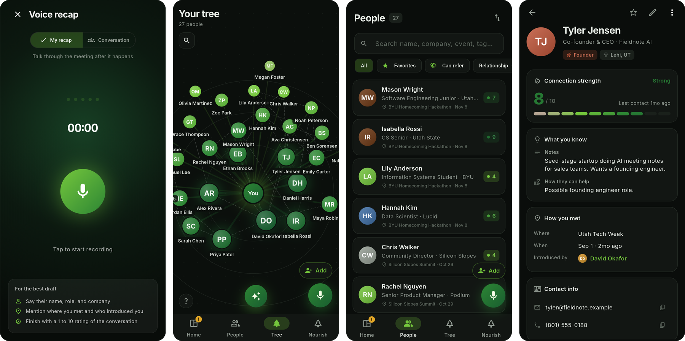
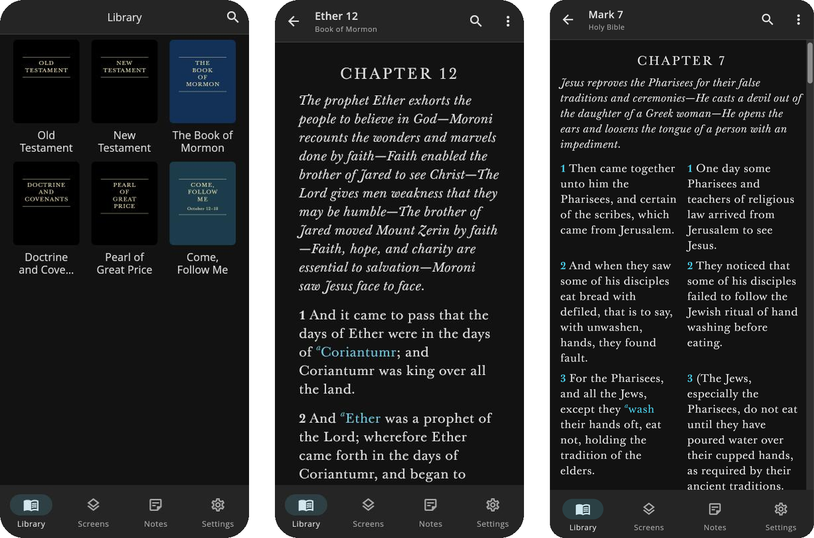
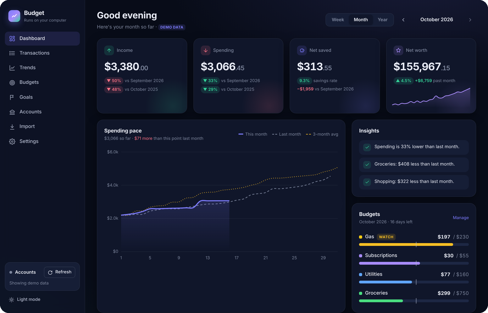
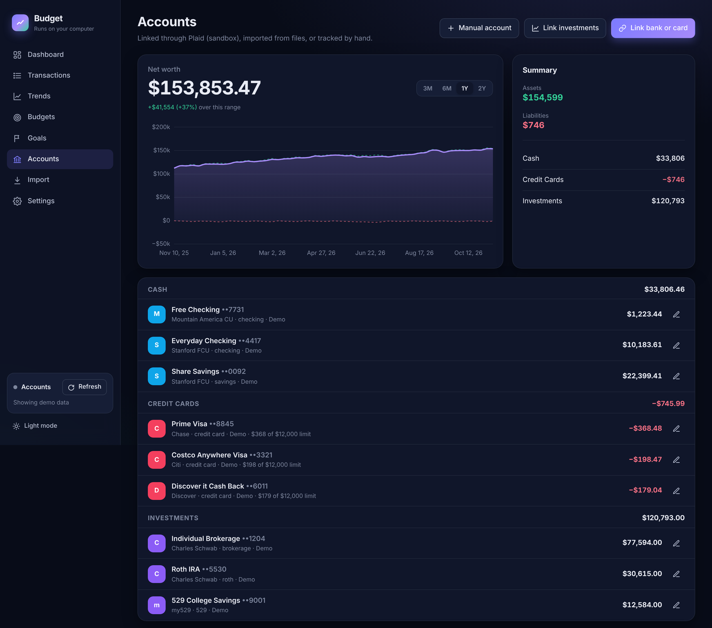
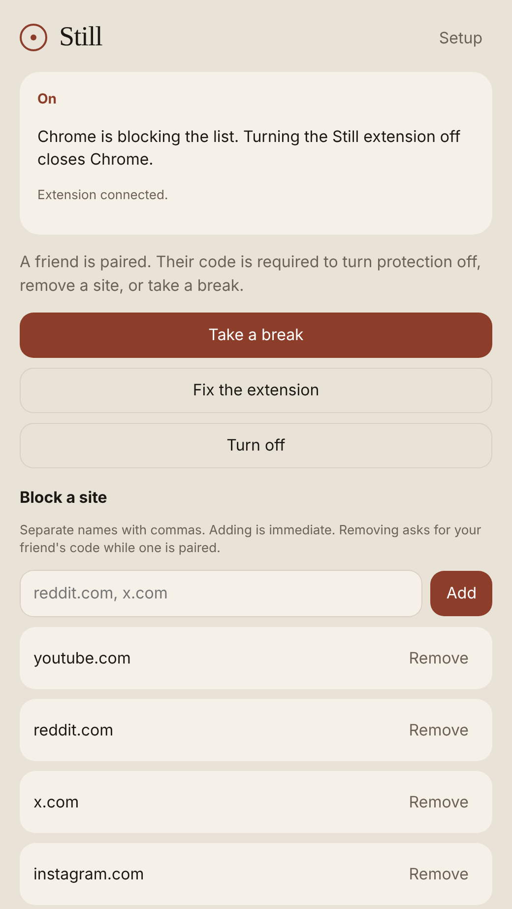
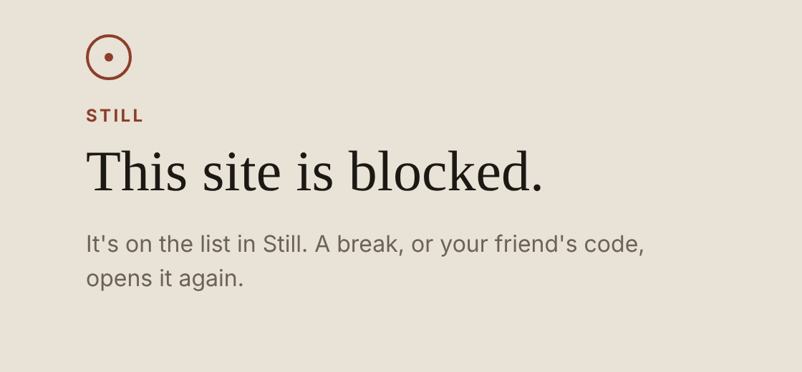
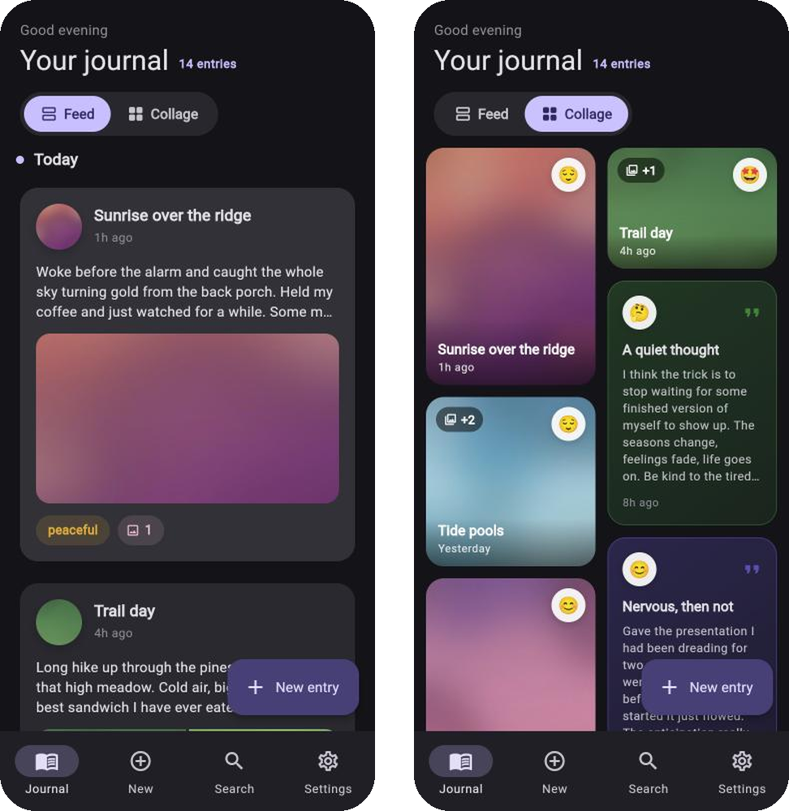
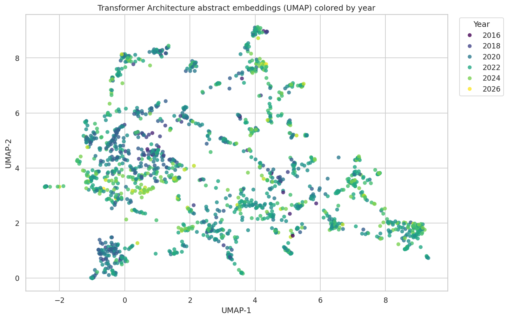

# Hi, I'm Dallin

[Resume (PDF)](assets/Dallin_Jacobs_Resume.pdf) · [dallin62@byu.edu](mailto:dallin62@byu.edu)

I'm a machine learning student at BYU (B.S. Machine Learning, graduating April 2027). I like building things people actually use, and most of the projects below started as something I wanted for myself.

Right now I'm cofounding **Argus**, a stove-safety startup, leading the computer vision team at BYU's Record Linking Lab, and researching how LLMs handle ethics and faith in BYU's PCCL lab.

---

## Projects

Most of these are in private repos. I'm happy to walk through any of the code.

### Argus

Stove safety for older adults, and a startup I'm building with friends. Argus is a smart plug for the stove that turns it off automatically after a set time and alerts you when it's been left on. It also tracks usage, so families can worry less about a parent who lives alone. The app pairs with the plug over Bluetooth and controls it on the local network or through the cloud.

`Flutter` `Bluetooth LE` `Shelly local + cloud APIs` `ESP32` `Raspberry Pi`

### Red Scribe

An AI medical scribe I designed and built at Red Compass Health. The provider records a patient visit, and Red Scribe transcribes it and drafts the chart note and treatment plan in the clinic's own format, ready to review and sign. It syncs with the clinic's EHR and CRM, so visit data and appointment reminders don't have to be entered twice. Patient data stays in HIPAA-compliant storage.

`OpenAI transcription + LLMs` `RAG` `Google Cloud` `EHR + CRM APIs`

### Spruce

**1st place, BYU Homecoming Hackathon**

Spruce helps you keep track of the people you meet. After a conversation, you record a quick voice recap. Spruce transcribes it, drafts a contact with notes, and adds that person to your network, where you can search it later ("who do I know in biotech?") and see how people connect. It was a team project, and I built most of it: the Flutter app, the API, and the transcription and search pipeline.

`Flutter` `FastAPI` `PostgreSQL + pgvector` `Gemini` `Render`

[Live app](https://spruce.my) · [Code](https://github.com/wwwillott/cs-homecoming-hackathon)

### Gospel Library 2.0

A scripture reader for web, iOS, and Android. It covers the basics of the Gospel Library app and adds what I kept wishing it had: side-by-side compare across books and Bible translations, search by meaning instead of exact wording, and highlights and notes that sync across devices.

`Flutter` `Firebase` `OpenAI embeddings`

[Live app](https://gosepl-library.web.app)

### Budget

A personal finance dashboard that runs on your own computer. It pulls transactions from your banks through Plaid or imports bank export files. It categorizes everything and shows spending pace, budgets, savings goals, and net worth. Your data lives in a local database, not someone else's server.

`Python` `FastAPI` `SQLite` `Plaid`

### Still

A distraction blocker for my phone and my computer, built so I can't talk myself out of it. A friend holds a rotating authenticator code, and I need that code to turn protection off, remove a site, or take a break. Breaks end on their own after at most 15 minutes. On Android, Still runs a local DNS-only VPN that answers lookups for blocked sites with NXDOMAIN and leaves all other traffic alone. On Windows, a Tauri app drives a Chrome/Edge extension that blocks the list, and it closes the browser if the extension is turned off. Both share the same friend code, and five wrong codes lock entry for 10 minutes.

`Kotlin` `Jetpack Compose` `Android VpnService` `Rust` `Tauri` `React` `TOTP`

&nbsp;&nbsp;

### Sib-journal

A voice-first journal. You talk for a minute, and it transcribes the recording, cleans it up into a readable entry with a title and mood, and makes your entries searchable by meaning ("times I felt overwhelmed"). Entries are stored on your device.

`Flutter` `Riverpod` `Whisper` `OpenAI embeddings`

[Live app](https://dallinmj.github.io/Sib-journal/)

### Kingdom Rush Agent

Lets Claude Code or Codex play Kingdom Rush Battles on a real Android phone. A local MCP server streams the phone screen over USB, finds empty tower pads and reads gold and prices with template matching and OCR, and gives the model semantic actions like "build tower on pad 2" instead of raw taps. Each action runs as a guarded macro that checks the screen is fresh and the purchase is valid before it commits, so a stale frame can't trigger a wrong buy. In early hands-off trials it won four matches in a row, though it isn't reliable yet.

`Python` `MCP` `scrcpy + ADB` `OpenCV` `OCR`

### ML Research Trends

How fast are different areas of ML research growing? We pulled papers from Semantic Scholar on transformers, RAG, chain-of-thought reasoning, and vision-language models. We embedded the abstracts with Qwen3-Embedding-4B and built a Python package and Streamlit app to explore the results.

`Python` `Semantic Scholar API` `Qwen3 embeddings` `UMAP` `Streamlit`

[Project site](https://dallinmj.github.io/ml_research_trends/) · [Code](https://github.com/dallinmj/ml_research_trends)

---

## Research

- **Computer Vision Team Lead**, BYU Record Linking Lab (advisor: Dr. Joe Price). I lead a five-person team reading handwritten historical records for FamilySearch. We extracted 7.9 million 1930s Paris census records, raised WWI draft card extraction accuracy from 73% to 97% with an ensemble of 15 fine-tuned models, and got a 112x throughput gain on LLM OCR with vLLM.
- **Research Assistant**, BYU Perception, Control, and Cognition Lab (advisor: Dr. David Wingate). I built a pipeline that pulled ethical questions out of 3.2 million ChatGPT conversations, benchmarked 27 LLMs on ethics and faith, and use interpretability methods to study why models leave religion out of their answers.
- **Paper:** [Omissive Bias in Religious Representation: Benchmarking LLM Answers to Everyday Ethical Decision-making](https://arxiv.org/abs/2605.24319) (coauthor, 2026 preprint)
- **[Multi-modal Education AI](https://github.com/BYU-PCCL/multi-modal-education-ai):** PCCL research code that turns a lesson prompt into a Manim math animation.

## Experience

- **Cofounder & Software Engineer**, Argus Home (2026–present)
- **AI & Software Engineer**, Red Compass Health (2024–present): Red Scribe, plus EHR and CRM integrations
- **Software Engineer**, White Pine Financial: Python automation for investment workflows
- **Leader**, BYU AI Club (2026–present): workshops and hackathons on using AI well

**Tools I use most:** Python, PyTorch, Hugging Face, vLLM, Dart/Flutter, Kotlin, Java, JavaScript, SQL, FastAPI, Firebase
